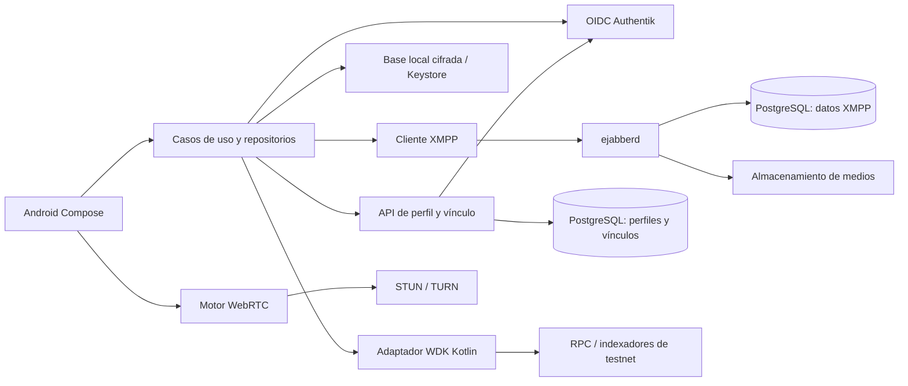

# Hoja de ruta: wallet y mensajería con pagos

**Estado:** propuesta técnica y de producto · **Fecha:** 2026-10-03 · **Plataforma inicial:** Android, Kotlin y Jetpack Compose.

## 1. Visión y límites del producto

Construir una aplicación Android que permita custodiar una wallet propia, conversar y pagar a un contacto desde el chat. La experiencia toma como referencias la unión de conversación y pagos de Mixin, la claridad de Telegram y la identidad vinculada a wallet de Status. Es una referencia funcional y de patrones de uso; la marca, iconografía y pantallas deben tener identidad propia.

**Orden de trabajo:** primero una wallet confiable y agradable de usar; después identidad y mensajería; luego pagos integrados, medios, llamadas y madurez operativa. Hasta que se cumplan las puertas de seguridad de la sección 8, todo se mantiene en **Sepolia y Bitcoin testnet4**. No se promete dinero real ni compatibilidad con redes principales por tener una versión 2.0.

### Principios de producto

1. El usuario conserva la semilla y autoriza cada envío. Authentik inicia sesión en la cuenta social; no custodia ni recupera automáticamente los fondos.
2. La identidad de chat puede descubrir una wallet, pero la dirección de cobro siempre se verifica y se muestra junto con la red, el activo y el importe antes de pagar.
3. El chat informa sobre el pago; la cadena determina su estado. Un mensaje entregado o un hash de emisión no son una confirmación financiera.
4. La wallet debe funcionar sin cuenta social durante las primeras versiones y, después, seguir mostrando saldos y direcciones locales aunque la sesión social caduque.
5. Cada pantalla debe explicar lo que el usuario puede hacer, lo que está cargando y lo que salió mal. No se mostrarán importes fiduciarios de relleno.

### Alcance

Incluido en esta hoja de ruta: wallet no custodial de ETH Sepolia y BTC testnet4, etiquetas, contactos, mensajes individuales y de grupo, pagos por chat, imágenes, notas de voz, ubicaciones, videollamadas 1:1, protección de privacidad, notificaciones y sincronización entre dispositivos. Tokens adicionales y otras redes se evalúan después de consolidar el flujo de monedas nativas.

Fuera del alcance hasta una decisión separada: intercambio de activos, pasarelas fiat, bots, canales públicos, tiendas de miniaplicaciones, custodia del servidor, puentes entre cadenas y una copia visual literal de otras apps.

## 2. Diagnóstico del repositorio actual

| Área | Lo que existe hoy | Brecha que condiciona el plan |
| --- | --- | --- |
| Base | Una app Android, Compose Material 3, tema oscuro, `minSdk 33`, `targetSdk 35`, módulo local `../wdk-core-kotlin`. | No hay módulos de identidad, datos o chat; la dependencia local debe fijarse y poder reproducirse en CI. |
| Wallet | Crear/importar 12 palabras, derivar direcciones ETH/BTC, consultar saldos, enviar, cotizar comisiones, recibir con QR y firmar/verificar. | Faltan recuperación guiada, validación completa del envío, historial persistente y pruebas de integración. |
| Estado | `WalletViewModel` concentra estado, WDK y navegación; `Screens.kt` reúne pantallas y `Components.kt` piezas compartidas. | Conviene extraer repositorios y casos de uso antes de agregar chat para evitar una clase única cada vez mayor. |
| Seguridad | Clave de cifrado y semilla cifrada se guardan juntas en `SharedPreferences`; `allowBackup=true`. | La protección local y la política de copias son una tarea prioritaria. No agregar más secretos ahí. |
| Envíos | `PendingTx` solo vive en `StateFlow`, el hash se etiqueta como `COMPLETED/Broadcast`, se borra al salir de envío. | Persistir la intención y distinguir preparación, emisión, confirmaciones, fallo y estado incierto. |
| Importación/restauración | La restauración borra credenciales ante cualquier error; la importación puede avanzar a Home aunque la inicialización falle. | Tratar errores de red por separado, no perder la wallet ni mostrar una sesión operativa falsa. |
| Datos de cartera | ETH y BTC se convierten a `Double` para mostrarse; el máximo BTC se aproxima con balance menos margen de comisión; las filas muestran `$0.00`. | Usar unidades enteras/`BigDecimal`, cálculo de máximo por red y eliminar valores fiat ficticios. |
| Interfaz y pruebas | Inicio, crear, importar, Home, enviar, recibir y firmar; una prueba JUnit pequeña. | Diseño de componentes, accesibilidad, estados vacíos, pruebas de flujos críticos y medición real en dispositivo. |

La documentación de WDK distingue envío de confirmación en cadena y ofrece APIs de transacción normalizadas en sus módulos actuales; **hay que verificar qué expone realmente el puente Kotlin instalado** antes de planificar una llamada concreta. Para BTC, la API actual documenta un cálculo de máximo gastable sensible a UTXO y comisiones. [WDK Core](https://docs.wdk.tether.io/sdk/core-module/api-reference/), [WDK BTC](https://docs.wdk.tether.io/sdk/wallet-modules/wallet-btc/api-reference/).

**Estado de v0.1:** existe una demostración parcial, no una versión cerrada. Los criterios siguientes indican qué faltaría para etiquetarla como entrega.

## 3. Experiencia de wallet que queremos alcanzar antes del chat

### Navegación e interfaz

- Inicio con saldo por activo y red, acciones primarias **Enviar / Recibir**, actividad reciente y un distintivo inequívoco de testnet. Firma de mensajes queda en herramientas avanzadas.
- Lista de activos legible: símbolo, nombre, red, saldo exacto y estado de sincronización. Si se añade precio fiat, indicar fuente, fecha y si está desactualizado; mientras tanto, no mostrar `$0.00` simulado.
- Detalle por activo: saldo disponible y pendiente, dirección, transacciones filtrables, estados y enlace al explorador correcto.
- Enviar en pasos: elegir activo y red → introducir/escoger destinatario → importe → comisión actual → revisar dirección completa y total → confirmar con desbloqueo local → seguir estado. El botón se bloquea mientras haya una operación en curso.
- Recibir: elegir activo/red, QR y dirección, copiar/compartir, advertencia sobre red incorrecta y confirmación cuando la entrada aparezca en cadena. El QR codifica una dirección o URI compatible tras verificar qué admite cada red.
- **Tags/etiquetas:** etiquetas libres para contactos y movimientos (`Familia`, `Trabajo`, `Ahorro`), además de categorías de sistema (`Entrante`, `Saliente`, `Pendiente`). Guardar etiquetas como metadatos locales; jamás incrustar etiquetas privadas en la transacción pública. Búsqueda y filtros por etiqueta.
- Diseño propio: paleta oscura cuidada con contraste accesible, tipografía clara, jerarquía de importes, márgenes coherentes, iconografía uniforme, estados vacíos y de error, animaciones discretas y textos en español; preparar internacionalización.

### Comportamientos financieros obligatorios

- Cantidades en unidades menores enteras; validación de signo, cero, decimales y límites antes de llamar a WDK. Cotización vinculada a **esa dirección y ese importe**, con caducidad y recotización al confirmar.
- Validación de formato y red de dirección; comprobar saldo disponible, comisión y total. `Max` ETH y `Max` BTC deben usar cálculo específico por cadena y distinguir saldo confirmado/pendiente según política explícita.
- Historial local persistente reconciliado con fuente de cadena: transacción preparada, pendiente de firma, emitida, pendiente de confirmación, confirmada, final, fallida o de resultado desconocido. Un error de conexión posterior a la emisión exige consulta antes de ofrecer reintento.
- Cancelación o reemplazo solo si la red y el puente WDK lo soportan y se ha probado; nunca prometerlo por defecto. Entrada detectada y fondos utilizables son estados distintos.
- Errores recuperables: red caída, proveedor caído, comisión cambiada, fondos insuficientes, dirección inválida y sesión local bloqueada. Mensajes útiles sin filtrar secretos ni errores internos completos.

## 4. Arquitectura objetivo y responsabilidades



| Componente | Responsabilidad y frontera de confianza |
| --- | --- |
| Android | UI, sesión local, cifrado local, claves de wallet, firma y emisión por WDK, base de datos local para historial/chat, cliente XMPP y medios. Semilla y claves privadas no salen del dispositivo por API propia. |
| Authentik | Identidad OIDC: alta, inicio de sesión, recuperación de la cuenta social, MFA y revocación. `sub` estable es la referencia de usuario, no correo, teléfono ni nombre visible. Cliente Android público con authorization code + PKCE. [Authentik OAuth2/OIDC](https://docs.goauthentik.io/add-secure-apps/providers/oauth2/). |
| Servicio de perfil/vínculo | Valida tokens de Authentik, asigna JID estable, publica direcciones verificadas, conserva versiones y revocaciones de vínculos, preferencias y controles de privacidad. No recibe semilla. Debe tener permisos mínimos y auditoría de cambios. |
| ejabberd | Transporta XMPP, presencia, archivo, grupos y subida de medios según módulos habilitados; PostgreSQL para datos XMPP. Su mecanismo de autenticación se decide tras una prueba real con Authentik. [Autenticación](https://docs.ejabberd.im/admin/configuration/authentication/), [PostgreSQL](https://docs.ejabberd.im/admin/configuration/database/), [módulos](https://docs.ejabberd.im/admin/configuration/modules/). |
| PostgreSQL | Esquemas/credenciales separadas para ejabberd y perfil. Guarda `authentik_sub`, JID, direcciones públicas, pruebas y versiones; nunca la frase semilla, clave privada ni material para descifrarla. |
| Medios y llamadas | Almacenamiento con cuotas, expiración y control de acceso; WebRTC para audio/video, XMPP/Jingle o señalización acordada para establecer llamada y STUN/TURN para conectividad. [XEP-0363](https://xmpp.org/extensions/xep-0363.html), [XEP-0166](https://xmpp.org/extensions/xep-0166.html). |

**Decisión por validar en v0.4:** ejabberd documenta JWT, OAuth propio y autenticación externa, pero eso no prueba que acepte directamente el access token OIDC de Authentik. En particular, su método JWT exige un JID y advierte una limitación para `mod_offline` cuando las cuentas no existen en su base. Hacer un prototipo con dos cuentas y sesiones revocadas, comparar puente de tokens de corta duración frente a autenticación externa/JWT y escoger una ruta con soporte de archivo y usuarios desconectados. No emitir contraseñas XMPP permanentes en Android como atajo. [Autenticación JWT de ejabberd](https://docs.ejabberd.im/admin/configuration/authentication/).

### Modelo mínimo de identidad y vínculo

```text
UserProfile: authentik_sub, jid, display_name, avatar_ref, created_at, status
WalletBinding: id, authentik_sub, chain_id, network, address, proof,
               challenge_id, verified_at, version, revoked_at
Contact: owner_sub, peer_sub/jid, nickname, trust_state, tags
PaymentIntent: id, conversation_id, sender_sub, recipient_sub,
               binding_id/version, chain_id, asset_id, amount_minor,
               quote_expires_at, state, tx_hash?, created_at
ChatPaymentEvent: conversation_id, payment_intent_id, public_tx_hash?, state
```

El vínculo se crea con un desafío del servidor que incluye dominio, `sub`, JID, red, dirección, nonce y expiración. El móvil lo firma con WDK; el servidor verifica la firma, la dirección y el nonce antes de publicar una versión. Evaluar por separado la prueba de propiedad BTC según las capacidades reales del puente Kotlin. Cambios de wallet y restauraciones requieren una versión nueva, invalidación de la anterior, historial de auditoría y aviso a contactos. El perfil muestra solo direcciones autorizadas por el usuario.

### Pago dentro del chat

1. El remitente toca **Pagar** o responde a una solicitud de cobro. La aplicación solicita el vínculo público vigente del destinatario y comprueba autenticidad, red y versión; no interpreta una dirección escrita en texto libre como vínculo confiable.
2. Muestra activo, red, dirección completa o verificación de contacto, importe en unidades exactas, comisión, total y antigüedad de la cotización. Si el vínculo cambió, vuelve a pedir revisión.
3. El usuario confirma localmente. WDK firma/emite desde Android. La intención de pago local se persiste antes de emitir y tiene ID único para deduplicar la experiencia; ese ID no garantiza idempotencia de la cadena.
4. Tras recibir hash, la app publica en XMPP una **referencia** de pago con ID, red, activo, importe y hash. No publica material secreto ni usa el mensaje como prueba de liquidación.
5. Emisor y receptor consultan la cadena/indexador confiable. La tarjeta del chat pasa de `enviado` a `confirmado/final` solo tras reconciliación; el receptor verifica que el pago se dirigió a una dirección suya y que el importe coincide. Un hash ausente en un fallo de red deja estado `desconocido` hasta investigar, sin reenvío automático.

## 5. Versiones y criterios de salida

Las versiones son **secuenciales por dependencia**, no compromisos de fecha. Cada una termina con demostración en dos dispositivos API 33+ cuando aplique, pruebas automatizadas útiles, documentación de operación y revisión de riesgos. El nombre de versión del APK se ajustará al producto al preparar entregas; el `versionName "1.0"` actual pertenece al starter y no representa esta hoja de ruta.

### v0.1 — Base wallet reproducible

**Entregar:** compilar e instalar de forma repetible con JDK 17 y el módulo WDK fijado; crear/importar wallet, mostrar ETH Sepolia y BTC testnet4, recibir por QR, enviar un importe pequeño y firmar/verificar. Corregir importación que navega a Home tras un fallo, preservar credenciales ante error transitorio de restauración y distinguir “emisión” de “confirmación”. Eliminar saldos fiat ficticios y revisar etiquetas actuales de testnet y red.

**Aceptación:** dos instalaciones limpias, restauración tras cierre forzado, operación de envío y recepción por red, error de proveedor simulado sin borrado de wallet, exploradores que correspondan a la cadena real. Documentar que el endpoint BTC configurado corresponde a testnet4 y verificarlo al ejecutar pruebas.

### v0.2 — Wallet pulida, recursos y seguridad local

**Entregar:** sistema visual propio, componentes de activos/importes/estados, navegación de wallet y detalle de activo; recursos gráficos originales y accesibles (iconos vectoriales, ilustración de bienvenida, fondos sobrios, QR legible), textos en recursos Android, español e inglés, tamaño de letra escalable y contraste revisado. Flujo de copia/compartir con aviso de red, biometría o credencial del dispositivo para desbloquear operaciones sensibles, semilla mostrada solo cuando corresponde y con confirmación real de respaldo.

**Seguridad:** mover la protección del secreto a Android Keystore y almacenamiento cifrado apropiado, excluir claves y semilla de copias Android, plan de migración de instalaciones existentes, eliminación verificable de secretos al borrar wallet y prueba en dispositivo restaurado. La presencia de hardware seguro se detecta; no se supone universal. [Android Keystore](https://developer.android.com/privacy-and-security/keystore), [copias de seguridad](https://developer.android.com/privacy-and-security/risks/backup-best-practices).

**Aceptación:** evaluación de accesibilidad con TalkBack y tamaños de fuente, capturas de pantallas clave, recuperación/migración sin pérdida de fondos en testnet, inspección de backup sin secretos, ningún valor monetario calculado con `Double`.

### v0.3 — Envío y recepción confiables

**Entregar:** validación por red, cálculo de comisiones por transacción, pantalla de revisión, máximo gastable correcto, historial persistente de entradas y salidas, reconciliación y estados de confirmación; etiquetas y búsqueda por activo, fecha, contacto y tag. Estados vacíos, sin conexión y de proveedor degradado. Guardar intento y hash antes de salir de la pantalla. Evaluar APIs del puente Kotlin para historial/recibos; si faltan, definir adaptador de lectura con pruebas antes de usar un indexador adicional.

**Aceptación:** pruebas con fondos de testnet de envío, recepción, fondos insuficientes, cambio de comisión, reinicio durante envío, timeout posterior a emisión, duplicación de respuesta y BTC con UTXO insuficiente. No se presenta “confirmado” al recibir solo un hash. La UI conserva una transacción desconocida para reconciliarla después.

### v0.4 — Cuenta, identidad y laboratorio XMPP

**Entregar:** despliegue de desarrollo reproducible de Authentik, ejabberd y PostgreSQL, dominios/TLS, dos usuarios de prueba, API de perfil y vínculo, alta/inicio/cierre de sesión Android con OIDC + PKCE, JID estable y enlace firmado de direcciones. Prototipo de autenticación XMPP con renovación/revocación de sesión y archivo mientras destinatario está desconectado. Separar bases o esquemas y credenciales de servicio. Prueba de restauración de la cuenta social sin wallet y de wallet sin sesión social.

**Aceptación:** crear dos cuentas, cerrar/revocar una sesión y comprobar que no accede al XMPP; cambiar dirección vinculada e invalidar la anterior; restaurar la wallet en otro dispositivo y solicitar nuevo vínculo. Registrar la decisión exacta de autenticación de ejabberd, incluyendo efecto sobre `mod_offline` y MAM.

### v0.5 — Chat individual útil

**Entregar:** lista de conversaciones, contactos por alias/identificador, búsqueda, solicitudes de contacto, bloqueo, texto 1:1, entrega, lectura, borradores, historial local y sincronización al reconectar. XMPP con gestión de flujo, IDs estables y MAM en ejabberd con PostgreSQL; definir política de retención. UI de chat con burbujas limpias, fecha, avatar, estado y accesos **Pagar/Solicitar** visibles pero inactivos hasta v0.7.

**Aceptación:** dos dispositivos en redes intermitentes intercambian mensajes sin duplicados visibles tras reconectar, un destinatario desconectado recupera historial y bloqueo impide nuevos contactos según política. El teléfono sin conexión distingue pendiente de entregado. [MAM/XEP-0313](https://xmpp.org/extensions/xep-0313.html), [mod_mam](https://docs.ejabberd.im/admin/configuration/modules/).

### v0.6 — Privacidad y fiabilidad del chat

**Entregar:** cifrado de extremo a extremo para texto 1:1, gestión de claves por dispositivo, verificación de huellas/códigos de seguridad, avisos de cambio de clave, copias y recuperación explícitas. Evaluar una implementación Android mantenida de OMEMO y su compatibilidad real con ejabberd y otros clientes antes de prometer interoperabilidad. Las notificaciones push no incluyen texto sensible; preparar puente móvil de push. Medir reconexión, consumo de batería y manejo de sesión.

**Aceptación:** prueba con servidor que almacena solo carga cifrada para conversaciones protegidas; cambio de dispositivo no descifra historial anterior por accidente; mensajes no se pierden al reconectar; verificación de contacto visible. OMEMO es una especificación **experimental**, por lo que requiere revisión de interoperabilidad y seguridad del cliente elegido. [OMEMO/XEP-0384](https://xmpp.org/extensions/xep-0384.html), [push/XEP-0357](https://xmpp.org/extensions/xep-0357.html).

### v0.7 — Enviar y solicitar dinero desde el chat

**Entregar:** tarjeta de wallet del contacto con vínculo verificado y versión, solicitud de cobro, revisión y confirmación del pago, tarjeta de estado en conversación, detección de depósito en wallet del receptor, tags para pagos/contactos y filtros relacionados. Límites locales configurables, advertencias ante nuevo dispositivo o vínculo cambiado. Nada de envío automático disparado por un mensaje.

**Aceptación:** pago ETH y BTC testnet4 entre dos usuarios; receptor ve pago solo cuando su propia dirección y cadena lo corroboran; chat entregado con transacción pendiente sigue pendiente; intento duplicado tras timeout se bloquea hasta reconciliar; cambio de dirección fuerza revisión nueva.

### v0.8 — Imágenes, notas de voz y ubicaciones

**Entregar:** selector Android de fotos/documentos, cámara si se justifica, previsualización y reducción controlada, mensajes de imagen; grabación y reproducción de notas de voz con duración y forma de onda opcional; envío de ubicación puntual mediante selector y permiso contextual, sin seguimiento continuo. Subida de medios con cuotas y expiración; cifrado de extremo a extremo de archivos si el chat protegido lo requiere, con claves fuera del servidor. Descargas bajo demanda y controles de datos móviles.

**Aceptación:** enviar/recibir medios entre dispositivos, reanudar fallos, borrar caché sin perder la conversación, archivos grandes rechazados con mensaje claro, ubicación no obtenida hasta consentimiento del usuario. Verificar límites de tamaño, retención y privacidad del servicio de subida. [HTTP File Upload/XEP-0363](https://xmpp.org/extensions/xep-0363.html), [mod_http_upload](https://docs.ejabberd.im/admin/configuration/modules/).

### v0.9 — Llamadas 1:1 y preparación de lanzamiento

**Entregar:** llamada de audio y videollamada 1:1 con señalización XMPP/Jingle evaluada frente a interoperabilidad real del cliente, WebRTC para medios, STUN/TURN, permisos contextuales, controles de silencio/cámara, rechazo, llamada perdida y recuperación de red. Monitorización sin grabar contenido; presupuesto de coste TURN y políticas de abuso. Ejecutar revisión externa de wallet, vínculo y mensajería antes de ampliar usuarios.

**Aceptación:** llamadas con Wi-Fi, datos móviles y NAT restrictivo; permisos denegados; interrupción y cambio de red; audio/video cifrados según el modelo elegido y documentado; una llamada fallida no altera pagos ni sesión. [Jingle/XEP-0166](https://xmpp.org/extensions/xep-0166.html).

### v1.0 — Producto integrado estable en testnet

**Entregar:** recorrido completo crear/restaurar wallet → iniciar sesión → vincular → chatear → pagar/recibir → verificar cadena; onboarding, ayuda, exportación de datos no secretos, borrado de cuenta social y desvinculación clara. Instrumentación de fallos, alertas de infraestructura, copias y restauración probada, límites de API, actualizaciones de dependencias y política de soporte. Publicación controlada/beta Android.

**Aceptación:** todos los flujos anteriores pasan en matriz de dispositivos; sin pérdida conocida de semilla, duplicación de pagos ni falsa confirmación; revisión de seguridad cerrada, pruebas de recuperación de PostgreSQL/medios, métricas operativas y soporte preparados. Cualquier avance a redes principales exige puerta adicional de la sección 8.

### v1.1 — Grupos y pagos referenciados

**Entregar:** grupos privados con invitación, administradores, lista de miembros, mensajes y medios; enlace a una solicitud de pago dirigida a un miembro concreto y visible solo a participantes autorizados. Revisión de cifrado grupal e historial al entrar/salir; pagos grupales masivos no se habilitan por defecto.

**Aceptación:** altas/bajas de miembros cambian el acceso a mensajes futuros, participantes bloqueados no reciben pagos por error, un pago conserva destinatario único y prueba de cadena.

### v1.2 — Varios dispositivos y restauración social

**Entregar:** sesiones por dispositivo, panel de dispositivos, revocación remota de acceso social/XMPP, sincronización de chat protegida y recuperación de claves de chat con explicación de límites. La wallet en un dispositivo nuevo se importa con respaldo del usuario o se vincula otra; Authentik no “recupera” la semilla.

**Aceptación:** revocación impide reconexión del dispositivo retirado; restaurar cuenta sin semilla muestra contactos/chat permitido y wallet vacía hasta importarla; no aparecen direcciones de otra persona o versión antigua.

### v1.3 — Robustez, accesibilidad y escala

**Entregar:** colas y reintentos acotados, monitoreo por red y proveedor, pruebas de carga de ejabberd/PostgreSQL, retención y purga de medios, moderación de abuso y reportes, localización completa, auditoría de accesibilidad y rendimiento. Revisar adopción de assets/tokens nuevos solo si historial, cotización, red y riesgo están cubiertos de extremo a extremo.

**Aceptación:** objetivos de la sección 7 medidos; simulacros de caída de RPC, Authentik, ejabberd y PostgreSQL; recuperar servicio sin reemitir pagos ni perder mensajes confirmados.

### v2.0 — Mensajería y wallet maduras

**Entregar:** interfaz consolidada de wallet y chat, identidad y vínculos verificables, pagos testnet fluidos, mensajes individuales/grupales protegidos, medios y llamadas 1:1, sincronización multidispositivo, administración de privacidad, operación documentada y SDK/adaptadores con contratos estables. Evaluar red principal y más activos solo con auditoría de seguridad, cumplimiento aplicable, proveedores robustos y plan de soporte aprobados por separado.

**Aceptación:** recorrido completo reproducible, métricas y pruebas bajo carga sostenida, accesibilidad validada, gestión de incidentes ensayada, revisiones externas cerradas y documentación actualizada. La versión 2.0 describe madurez funcional; no constituye por sí sola autorización para manejar valor real.

## 6. Dependencias y secuencia crítica

| Decisión o prueba temprana | Fecha límite en el plan | Por qué bloquea |
| --- | --- | --- |
| Inventario de APIs del `wdk-core-kotlin` fijado y soporte de recibos/historial/máximo | v0.2–v0.3 | No diseñar estados financieros basados solo en métodos del SDK JavaScript que quizá no exponga Kotlin. |
| Política de protección de semilla y migración de datos existentes | v0.2 | La cuenta social y el chat aumentan la superficie de ataque. |
| Política de saldo BTC testnet4 y proveedor/indexador | v0.3 | Evita confundir fondos pendientes con disponibles y testnet3 con testnet4. |
| Prototipo Authentik ↔ ejabberd con usuario desconectado | v0.4 | Define credencial, JID, revocación y almacenamiento antes de construir chat. |
| Elección de cliente XMPP Android y cobertura XEP | v0.4–v0.5 | Determina MAM, reconexión, OMEMO, subida y llamadas sin duplicar protocolo. |
| Modelo de cifrado de mensajes, metadatos y archivos | v0.5–v0.6 | Evita prometer privacidad que medios o notificaciones contradigan. |
| Protocolo de vínculo y pago, revisado con dos wallets reales de testnet | v0.6–v0.7 | Previene suplantación de destinatario y falsa confirmación. |
| Coste y fiabilidad de almacenamiento, push y TURN | v0.8–v0.9 | Impacta experiencia móvil y operación. |

## 7. Calidad, pruebas y operación

**Pirámide mínima:** pruebas unitarias de conversión de importes, validación de red, estados de transacción y vínculo; pruebas de contrato del adaptador WDK y API de perfil; integración con dos usuarios y ejabberd/Auth/PostgreSQL; UI automatizada de crear/importar/enviar/recibir/chat/pagar; pruebas manuales en API 33 y versiones actuales. Secretos y frases de prueba nunca en logs ni capturas compartidas.

**Objetivos iniciales medibles** (ajustar con beta): cero pagos emitidos dos veces por reintento automático; 100 % de tarjetas marcadas `confirmado` respaldadas por consulta de cadena; recuperación de chat tras reconexión en menos de 30 s en condiciones normales; inicio de wallet y lista de chats sin bloqueo perceptible del hilo principal; cero secretos de wallet en backup, telemetría y PostgreSQL. Medir tasa de fallos por red/proveedor, tiempo de cotización, confirmación y entrega, sesiones revocadas y coste de medios/TURN.

**Operación:** entornos local, staging testnet y beta aislados; secretos en gestor de secretos; TLS; migraciones versionadas de PostgreSQL; copias cifradas y restauraciones probadas; monitoreo y alertas; retención de MAM/medios documentada; protección de subida y abuso; pruebas de fallo de RPC, Authentik, ejabberd, DB y push. Revisar licencias de clientes XMPP, WebRTC y recursos gráficos antes de incorporarlos.

## 8. Puertas de seguridad y decisiones que no se deben saltar

- **Antes de v0.3:** la semilla queda protegida localmente, fuera de copias, con migración y recuperación probadas. Borrar una cuenta de chat no borra la wallet sin consentimiento explícito.
- **Antes de v0.7:** revisión de amenazas para suplantación de contacto, cambio de vínculo, replay de desafío, comprobación de firma por cadena, QR malicioso, reintento de transacción y separación de privilegios. La app nunca firma una solicitud financiera solo por recibir un mensaje.
- **Antes de v1.0:** evaluación externa de las partes críticas, cierre de hallazgos altos, recuperación de infraestructura ensayada y política de incidentes.
- **Antes de cualquier mainnet:** auditoría independiente de cliente, servidor de vínculo y configuración; límites de riesgo, revisión legal/compliance por jurisdicción y soporte de incidentes. Decisión de producto y despliegue separada de esta hoja de ruta.

## 9. Primer backlog ejecutable

1. Fijar commit/versión del módulo WDK local y levantar build reproducible; documentar llamadas Kotlin disponibles.
2. Corregir flujos de importación/restauración para conservar wallet ante fallos transitorios y no entrar en Home sin inicialización.
3. Sustituir presentación de importes `Double` y `$0.00`; definir tipos `AmountMinor`, `ChainId`, `AssetId` y `TransactionStatus`.
4. Persistir intentos e historial de envío, separar `broadcast` de `confirmed`, añadir reconciliación inicial.
5. Preparar sistema visual y recursos de v0.2 con pantallas Home, activo, enviar, revisar y recibir; revisar accesibilidad.
6. Implementar protección de secretos con Keystore, reglas de backup y migración de datos del starter.
7. Crear entorno local de Authentik/ejabberd/PostgreSQL y probar de forma aislada la autenticación XMPP y su revocación antes de escribir la UI de chat.

## Fuentes técnicas consultadas

- Repositorio local: `README.md`, `app/build.gradle`, `settings.gradle`, `AndroidManifest.xml`, `MainActivity.kt`, `WalletViewModel.kt`, `Screens.kt`, `Components.kt` y prueba JUnit existente.
- [WDK Core API](https://docs.wdk.tether.io/sdk/core-module/api-reference/), [WDK EVM send](https://docs.wdk.tether.io/sdk/wallet-modules/wallet-evm/guides/send-transactions/), [WDK BTC API](https://docs.wdk.tether.io/sdk/wallet-modules/wallet-btc/api-reference/).
- [Authentik OAuth2/OIDC](https://docs.goauthentik.io/add-secure-apps/providers/oauth2/).
- [ejabberd autenticación](https://docs.ejabberd.im/admin/configuration/authentication/), [base de datos](https://docs.ejabberd.im/admin/configuration/database/), [módulos](https://docs.ejabberd.im/admin/configuration/modules/).
- [XEP-0313 MAM](https://xmpp.org/extensions/xep-0313.html), [XEP-0384 OMEMO](https://xmpp.org/extensions/xep-0384.html), [XEP-0363 subida](https://xmpp.org/extensions/xep-0363.html), [XEP-0357 push](https://xmpp.org/extensions/xep-0357.html), [XEP-0166 Jingle](https://xmpp.org/extensions/xep-0166.html).
- [Android Keystore](https://developer.android.com/privacy-and-security/keystore), [Android backup](https://developer.android.com/privacy-and-security/risks/backup-best-practices), [Mixin Messenger como referencia funcional](https://messenger.mixin.one/how-it-works).
